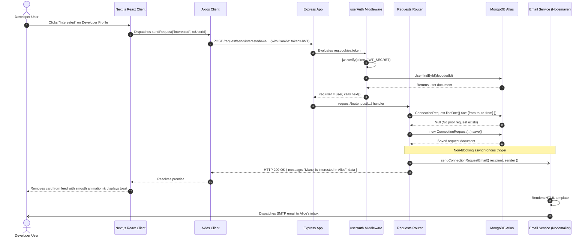

# Document 02: Technology Stack & Architecture

## 1. Complete Technology Stack Analysis

Every technology in the HackPair platform was chosen to maximize type safety, developer velocity, runtime efficiency, and security.

### A. Frontend Technologies

| Technology | Version / Package | Where It Is Used | Why It Was Chosen & Problems Solved | Alternatives & Trade-offs |
| :--- | :--- | :--- | :--- | :--- |
| **Next.js** | `16.4.4` (App Router) | Entire frontend framework (`src/app/*`) | Enables server-side layout management, modern client component hydrations, built-in routing, and metadata handling. | *Vite + React SPA*: Lacks built-in file-system routing and native SEO optimization. |
| **React** | `19.3.0` | UI Component Engine | State synchronization, hooks (`useEffect`, `useState`, `useCallback`, `useRef`), and concurrent rendering. | *Vue / Svelte*: React offers the largest ecosystem and established state-management paradigms. |
| **Axios** | `^1.21.0` | Centralized API client (`src/helpers/axios.js`) | Automatically passes `withCredentials: true` across all requests to transport HTTP cookies, handles interceptors, and streamlines JSON parsing. | *Native `fetch`*: Fetch requires manual cookie configuration, explicit stringification, and extra `.json()` handling steps. |
| **Socket.IO Client** | `^4.8.4` | WebSocket communication (`src/helpers/socket.js`, `ChatPageView`) | Manages real-time bi-directional messaging, heartbeat checks, automatic reconnection, and cookie-based handshake auth. | *Native WebSockets*: Lacks automatic reconnect, room namespaces, and fallback to HTTP long-polling. |
| **CSS Modules & Sass** | `^1.107.1` | Component-level styling (`*.module.css`) | Provides strict CSS scoping without style leakage, supports nested rules, and leverages CSS variables for theme consistency. | *Tailwind CSS*: While Tailwind is fast, CSS Modules separate layout logic from markup, keeping JSX clean. |
| **React Hot Toast** | `^2.6.1` | User notification alerts (`AuthContext`, hooks) | Lightweight (<5kb), declarative, highly customizable toast notifications that do not block user input. | *React Toastify*: Heavier bundle size. |
| **Framer Motion** | `^14.9.0` | Animation engine | Handles smooth transitions for feed swipes, modal drawers, and toast alerts. | *CSS Transitions alone*: Insufficient for complex unmount exit animations. |

---

### B. Backend Technologies

| Technology | Version / Package | Where It Is Used | Why It Was Chosen & Problems Solved | Alternatives & Trade-offs |
| :--- | :--- | :--- | :--- | :--- |
| **Node.js** | `v24.13.0` | Runtime environment | Non-blocking, asynchronous event-driven I/O ideal for real-time messaging and concurrent API workloads. | *Python/Django*: Python's GIL makes WebSockets and concurrent socket handling more resource-heavy. |
| **Express** | `^5.2.1` | Backend web framework (`src/app.js`, `src/routes/*`) | Mature, robust middleware ecosystem with native promise-based routing in Express 5. | *Fastify / NestJS*: Express provides minimal overhead and explicit control without boilerplate abstractions. |
| **Socket.IO** | `^4.8.1` | WebSocket server engine (`src/utils/socket.js`) | Establishes low-latency, full-duplex communication for 1-on-1 chats and real-time notification broadcasts. | *ws (raw)*: Raw `ws` requires manual implementation of rooms, heartbeats, reconnection, and cookie parsers. |
| **Mongoose** | `^9.11.2` | MongoDB Object Data Modeling (ODM) | Enforces schema validation, pre-save hooks, virtuals, custom methods (`getJWT`, `validatePassword`), and sanitization transforms (`toJSON`). | *Native MongoDB Driver*: Lacks declarative validation, middleware hooks, and model-level encapsulation. |
| **Bcrypt** | `^6.0.0` | Password hashing (`src/models/user.js`, `src/routes/auth.js`) | Adaptive, salted one-way hashing function designed to resist brute-force hardware cracking (cost factor 10). | *Argon2 / SHA-256*: Plain SHA-256 is vulnerable to GPU attacks; Argon2 has higher native compilation complexity. |
| **JsonWebToken** | `^9.0.3` | Session token generation & verification | Stateless authentication tokens signed cryptographically with a secret key, stored securely inside cookies. | *Server-side Sessions (Redis)*: Requires maintaining stateful cache storage across instances. |
| **Nodemailer** | `^6.10.0` | Transactional email transport (`src/services/emailService.js`) | Industry-standard SMTP client supporting Gmail SMTP without requiring custom DNS domain verification. | *Direct API calls*: Nodemailer provides transport-agnostic fallback flexibility. |
| **Resend** | `^4.1.2` | Cloud email API (`src/services/emailService.js`) | Modern developer-first transactional email API with outstanding deliverability for production environments. | *SendGrid / SES*: SES has complex AWS IAM and sandbox restrictions; SendGrid has frequent account suspensions. |
| **Helmet** | `^8.0.0` | Security HTTP headers (`src/app.js`) | Secures HTTP headers against MIME-sniffing, clickjacking, and cross-site scripting vulnerabilities. | *Manual headers*: Prone to misconfigurations. |
| **Express-Rate-Limit** | `^7.5.0` | Brute-force protection (`src/app.js`) | Rate-limits authentication endpoints (login, signup, password reset) to 25 requests per 15-minute window per IP. | *Redis-based rate limiters*: Unnecessary overhead for single-server setups. |
| **Validator** | `^13.15.35` | String and email validation (`src/utils/validation.js`) | Robust validation suite checking emails, strong password patterns, URLs, and numeric ranges. | *Regex alone*: Regex is prone to ReDoS (Regular Expression Denial of Service). |
| **Cookie-Parser** | `^1.4.7` | Cookie middleware (`src/app.js`) | Parses HTTP request cookie headers into easily accessible `req.cookies` properties. | *Manual parsing*: Error-prone string splitting. |
| **Cors** | `^2.8.6` | Cross-Origin Resource Sharing | Manages origin whitelisting, HTTP headers, and credential transmission across different client domains. | *Manual header injection*: Complex pre-flight (`OPTIONS`) handling. |

---

## 2. High-Level System Architecture Diagram

```mermaid
graph TD
    subgraph Client Tier
        Browser["User Browser (Desktop / Mobile)"]
        NextClient["Next.js 16 App Router (React 19)"]
        AxiosClient["Axios HTTP Client (withCredentials: true)"]
        SocketClient["Socket.IO Client (WSS)"]
    end

    subgraph CDN & Edge Tier
        Cloudflare["Cloudflare Edge (Pages / Proxy)"]
    end

    subgraph Backend Application Tier
        NodeServer["Node.js Native HTTP Server (Port 7777)"]
        ExpressApp["Express 5 Application Pipeline"]
        HelmetMW["Helmet Security Headers"]
        RateLimitMW["Express Rate Limiter"]
        CorsMW["Dynamic CORS Middleware"]
        CookieMW["Cookie-Parser Middleware"]
        AuthMW["userAuth JWT Verification"]
        SocketEngine["Socket.IO WebSocket Engine"]
    end

    subgraph Service & Controller Tier
        AuthRouter["Auth Router (/login, /signup, /forgot-password)"]
        FeedRouter["User Router (/feed, /connections, /requests)"]
        RequestRouter["Requests Router (/request/send, /request/review)"]
        ChatRouter["Chat Router (/chat/*)"]
        EmailService["Email Service (Nodemailer / Resend)"]
    end

    subgraph Data & Persistence Tier
        MongoDB["MongoDB Atlas Cloud Database"]
        UserCol["Users Collection"]
        ConnCol["ConnectionRequests Collection"]
        ChatCol["Chats Collection"]
    end

    subgraph Third-Party External Tier
        GmailSMTP["Google Gmail SMTP Server"]
        ResendAPI["Resend Cloud Email API"]
    end

    Browser --> Cloudflare
    Cloudflare --> NextClient
    NextClient --> AxiosClient
    NextClient --> SocketClient

    AxiosClient -->|HTTPS REST API Calls| CorsMW
    SocketClient -->|WebSocket Handshake (WSS)| SocketEngine

    CorsMW --> HelmetMW --> RateLimitMW --> CookieMW --> ExpressApp
    ExpressApp --> NodeServer
    NodeServer --> SocketEngine

    ExpressApp --> AuthRouter
    ExpressApp --> RequestRouter
    ExpressApp --> FeedRouter
    ExpressApp --> ChatRouter

    AuthRouter --> AuthMW
    RequestRouter --> AuthMW
    FeedRouter --> AuthMW
    ChatRouter --> AuthMW

    AuthRouter --> EmailService
    RequestRouter --> EmailService
    EmailService -->|SMTP Transport| GmailSMTP
    EmailService -->|REST Transport| ResendAPI

    AuthRouter --> UserCol
    FeedRouter --> UserCol
    FeedRouter --> ConnCol
    RequestRouter --> ConnCol
    ChatRouter --> ChatCol
    SocketEngine --> ChatCol
    SocketEngine --> ConnCol

    UserCol --> MongoDB
    ConnCol --> MongoDB
    ChatCol --> MongoDB
```

---

## 3. Directory Structure & Responsibilities

### Backend (`c:\Backend\hackpair-backend`)

```
hackpair-backend/
├── .env                              # Sensitive environment variables (Git-ignored)
├── .env.example                      # Production template for environment configuration
├── .gitignore                        # Git exclusion rules (node_modules, .env)
├── package.json                      # Backend dependencies, metadata, and startup scripts
├── package-lock.json                 # Pinned dependency tree
├── PROJECT_TECHNICAL_DOCUMENTATION/  # Complete architectural & interview guide
└── src/
    ├── app.js                        # HTTP server initialization, middleware stack & entry point
    ├── config/
    │   └── database.js               # MongoDB connection setup with Google Public DNS
    ├── middlewares/
    │   └── auth.js                   # JWT cookie verification middleware (userAuth)
    ├── models/
    │   ├── chat.js                   # Mongoose schema for conversations & messages
    │   ├── connectionRequest.js      # Schema for matchmaking state (interested/accepted/etc.)
    │   └── user.js                   # Schema for developer accounts, bcrypt methods & JWT generator
    ├── routes/
    │   ├── auth.js                   # Signup, login, logout, password recovery endpoints
    │   ├── chat.js                   # Unread counts, conversations, and message history APIs
    │   ├── profile.js                # Profile viewing, whitelisted editing & password modification
    │   ├── requests.js               # Sending and reviewing connection requests
    │   └── user.js                   # Feed query engine, connections list & received requests
    ├── services/
    │   └── emailService.js           # Multi-provider email dispatch engine (Nodemailer / Resend)
    └── utils/
        ├── socket.js                 # Socket.IO initialization, auth handshake & room routing
        ├── testEmail.js              # Diagnostic CLI script for testing email delivery
        └── validation.js             # Whitelists & regex validations for profile/signup payloads
```

### Frontend (`c:\personal-projects\hackpair-frontend`)

```
hackpair-frontend/
├── jsconfig.json                     # Path aliases (@/*, @/components/*, @/helpers/*, etc.)
├── package.json                      # Frontend dependencies (Next.js 16, React 19, Axios, Socket.IO)
├── next.config.mjs                   # Next.js bundler and image domain whitelist
└── src/
    ├── app/                          # Next.js App Router root
    │   ├── layout.js                 # Global HTML shell and AuthContext provider wrapper
    │   ├── page.js                   # Landing page
    │   ├── chat/                     # Dedicated live messenger route (/chat)
    │   ├── connections/              # Matched teammates view (/connections)
    │   ├── feed/                     # Developer matchmaking swipe feed (/feed)
    │   ├── login/                    # Authentication login portal (/login)
    │   ├── profile/                  # Developer profile inspection & edit (/profile)
    │   ├── requests/                 # Incoming request review portal (/requests)
    │   ├── signup/                   # Account registration portal (/signup)
    │   ├── styles/                   # Global CSS, variables, resets, and media breakpoints
    │   └── resources/
    │       └── components/           # Modular component architecture
    │           ├── auth/             # LoginCard, SignupCard
    │           ├── chat/             # ChatPageView (2-column messenger)
    │           ├── common/           # Header, Footer, Button
    │           ├── dashboard/        # DashboardShell, DashboardSidebar, ChatModal, ConnectionsView
    │           ├── feed/             # FeedView, DeveloperCard
    │           └── landing/          # HeroSection, HowItWorks, MatchShowcase, TechFeatures
    ├── context/
    │   └── AuthContext.jsx           # Global user state, login/signup/logout actions
    ├── helpers/
    │   ├── axios.js                  # Pre-configured Axios instance with credentials
    │   ├── site.js                   # Dynamic environment URLs (API_BASE_URL)
    │   └── socket.js                 # Singleton Socket.IO connection manager
    └── hooks/
        ├── use-auth.js               # Hook to access global authentication state
        ├── use-connections.js        # Hook to fetch and mutate connection requests
        └── use-feed.js               # Hook to load feed candidates and dispatch requests
```

---

## 4. End-to-End Request/Response Lifecycle

The following sequence illustrates how a client interaction flows across the entire platform:



