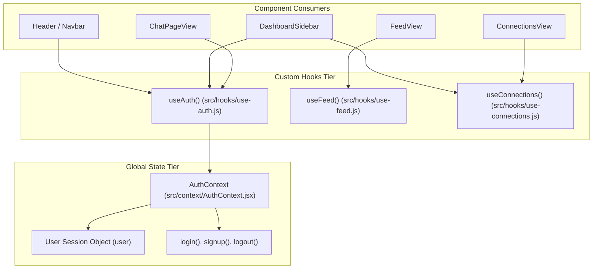

# Document 03: Frontend Architecture & Deep Dive

## 1. Application Structure & Routing Architecture

The HackPair frontend is engineered on **Next.js 16 (App Router)** and **React 19**, organized around a feature-first component hierarchy under `src/app`.

### Routing Hierarchy

| Route Path | Page Component | Rendering Strategy | Access Control | Purpose |
| :--- | :--- | :--- | :--- | :--- |
| `/` | `src/app/page.js` | Server / Client Hybrid | Public | Landing page showcasing value proposition, hero graphics, and matchmaking previews. |
| `/login` | `src/app/login/page.js` | Client Component | Public (Guests only) | Authentication portal with email and password inputs. |
| `/signup` | `src/app/signup/page.js` | Client Component | Public (Guests only) | Registration portal collecting developer details, skills, and bio. |
| `/feed` | `src/app/feed/page.js` | Client Component (`DashboardShell`) | Protected (Auth required) | Core matchmaking feed displaying candidate developer cards with "Interested" and "Ignore" actions. |
| `/requests` | `src/app/requests/page.js` | Client Component (`DashboardShell`) | Protected (Auth required) | Inbox for reviewing incoming collaboration requests with Accept/Reject actions. |
| `/connections`| `src/app/connections/page.js` | Client Component (`DashboardShell`) | Protected (Auth required) | Directory of all confirmed teammates with one-click direct chat launchers. |
| `/chat` | `src/app/chat/page.js` | Client Component (`DashboardShell`) | Protected (Auth required) | Full 2-column live messenger with conversation list, message thread, typing indicator, and search. |
| `/profile` | `src/app/profile/page.js` | Client Component (`DashboardShell`) | Protected (Auth required) | Profile viewer, bio and skills editor, and password management interface. |

---

## 2. Component Architecture & Reusability

The application avoids sprawling monolithic components by breaking views into modular sub-units located in `src/app/resources/components`:

```
src/app/resources/components/
├── auth/                 # Form cards for credentials
│   ├── login-card/       # Validated login form
│   └── signup-card/      # Multi-field developer onboarding form
├── chat/                 # Dedicated messenger views
│   └── chat-page-view/   # 2-column live chat workspace
├── common/               # Universal UI primitives
│   ├── button/           # Styled semantic button with states
│   ├── header/           # Global top navigation bar
│   └── footer/           # Global footer
├── dashboard/            # Authenticated workspace layout primitives
│   ├── dashboard-shell/  # Layout wrapper guarding authenticated routes & mobile tabs
│   ├── dashboard-sidebar/# Left navigation panel with dynamic unread badges
│   ├── developer-card/   # Candidate profile card with skill pills and interaction triggers
│   ├── connections-view/ # Grid of confirmed partners with live chat triggers
│   └── requests-view/    # List of pending requests with action buttons
├── feed/                 # Matchmaking components
│   └── feed-view/        # Feed state controller, pagination, and empty-state handler
└── profile/              # User account components
    ├── profile-view/     # Preview card matching feed appearance
    ├── profile-edit-card/# Whitelisted profile fields editor
    └── change-password-card/# Secure password update form
```

### The Workspace Template Pattern: `DashboardShell`
Instead of duplicating sidebars and navigation across `/feed`, `/requests`, `/connections`, `/chat`, and `/profile`, every authenticated screen wraps its content in [`DashboardShell`](file:///c:/personal-projects/hackpair-frontend/src/app/resources/components/dashboard/dashboard-shell/index.jsx):

```jsx
// src/app/resources/components/dashboard/dashboard-shell/index.jsx
const DashboardShell = ({ children, title, subtitle, actions, ...counts }) => {
    const { user, loading: authLoading } = useAuth();
    const router = useRouter();

    // Client-side authentication guard
    useEffect(() => {
        if (!authLoading && !user) {
            router.push("/login");
        }
    }, [authLoading, user, router]);

    if (authLoading || (!user && authLoading)) {
        return <div className={styles.initial_loading}>...</div>;
    }

    return (
        <div className={styles.dashboard_shell}>
            <DashboardSidebar user={user} {...counts} />
            <main className={styles.shell_main}>
                <div className={styles.mobile_tab_switcher}>...</div>
                <header className={styles.main_header}>
                    <h1>{title}</h1>
                    {actions && <div>{actions}</div>}
                </header>
                <div className={styles.content_body}>{children}</div>
            </main>
        </div>
    );
};
```

---

## 3. State Management Strategy

HackPair utilizes a **hybrid state management strategy** balancing centralized global context with localized custom hooks:



### A. Centralized Session State: `AuthContext.jsx`
Located in [`src/context/AuthContext.jsx`](file:///c:/personal-projects/hackpair-frontend/src/context/AuthContext.jsx):
- **On Initial Mount**: Immediately dispatches `GET /profile/view` via Axios.
- **Session Persistence**: Because the backend issues `HttpOnly` cookies, the client does not store tokens in `localStorage` (mitigating XSS extraction). If the cookie is valid, `/profile/view` resolves with the user record, populating `user` state and setting `loading = false`.
- **Automatic Login on Signup**: Upon completing registration, `signup()` automatically chains an immediate `login()` call, creating a seamless user onboarding experience without requiring double credentials entry.

### B. Specialized Data Hooks

#### 1. `useFeed.js` ([`src/hooks/use-feed.js`](file:///c:/personal-projects/hackpair-frontend/src/hooks/use-feed.js))
- Manages candidate recommendation lists.
- **Optimistic UI Mutation**: When the user clicks "Interested" or "Ignore", `sendRequest(status, toUserId)` dispatches the HTTP call and **immediately filters the candidate from local state** (`setFeed(prev => prev.filter(...))`), ensuring zero UI lag.
- Manages pagination (`page`, `hasMore`) and loads the next set of candidates.

#### 2. `useConnections.js` ([`src/hooks/use-connections.js`](file:///c:/personal-projects/hackpair-frontend/src/hooks/use-connections.js))
- Manages accepted partner lists (`connections`) and pending review items (`requests`).
- Handles `reviewRequest(status, requestId)` to accept or reject candidates, automatically evicting reviewed requests from state and updating total counts.

---

## 4. API Integration & Network Architecture

### Centralized Axios Client ([`src/helpers/axios.js`](file:///c:/personal-projects/hackpair-frontend/src/helpers/axios.js))
```javascript
import axios from "axios";
import { API_BASE_URL } from "./site";

const api = axios.create({
    baseURL: API_BASE_URL,
    withCredentials: true, // Vital: forces browser to include HttpOnly cookies across origins
    headers: {
        "Content-Type": "application/json",
    },
});

export default api;
```

### Error Handling & Toast Integration
All API calls are wrapped in defensive `try/catch` blocks. Error messages from backend response payloads (`err.response?.data?.message` or string bodies) are extracted and surfaced non-intrusively via `react-hot-toast`.

---

## 5. Real-Time Chat Architecture (Frontend)

Real-time live messaging is implemented in [`src/helpers/socket.js`](file:///c:/personal-projects/hackpair-frontend/src/helpers/socket.js) and consumed by [`ChatPageView`](file:///c:/personal-projects/hackpair-frontend/src/app/resources/components/chat/chat-page-view/index.jsx):

```javascript
// src/helpers/socket.js
export const getSocket = () => {
    if (!socketInstance || socketInstance.disconnected) {
        socketInstance = io(API_BASE_URL, {
            withCredentials: true,
            autoConnect: true,
            transports: ["websocket", "polling"],
        });
    }
    return socketInstance;
};
```

### Frontend WebSocket Flow in `ChatPageView`:
1. **Room Association**: When a user selects a partner, `socket.emit("joinChat", { targetUserId })` routes the socket into a private room.
2. **Read Receipts**: The client emits `socket.emit("markAsSeen", { targetUserId })` to clear unread counts.
3. **Message Dispatch**: Submitting the input emits `socket.emit("sendMessage", { targetUserId, text })`.
4. **Debounced Typing Indicators**: Typing into the input emits `socket.emit("typing", { targetUserId })`. A 1,500ms debounce timer automatically emits `stopTyping` when the user pauses.
5. **Auto-Scroll to Bottom**: A React `ref` attached to the stream bottom triggers `scrollIntoView({ behavior: "smooth" })` whenever `messages` or `isPartnerTyping` updates.

---

## 6. Styling, Responsive Design & CSS Architecture

- **Tokens & Variables** ([`src/app/styles/variables.css`](file:///c:/personal-projects/hackpair-frontend/src/app/styles/variables.css)): Defines unified color palettes (`--color-primary: #2563eb`), card backgrounds, text contrast tokens, and box shadows.
- **Media Breakpoints** ([`src/app/styles/breakpoints.css`](file:///c:/personal-projects/hackpair-frontend/src/app/styles/breakpoints.css)):
  - Desktop (>1400px): 3-column grids for connections and feeds.
  - Tablet (768px - 1024px): 2-column grids with collapsible navigation.
  - Mobile (<768px): Desktop sidebar hides; sticky bottom/top pill switcher activates. The 2-column messenger flips to a single-pane master-detail view with back-arrow navigation (`← All Chats`).

