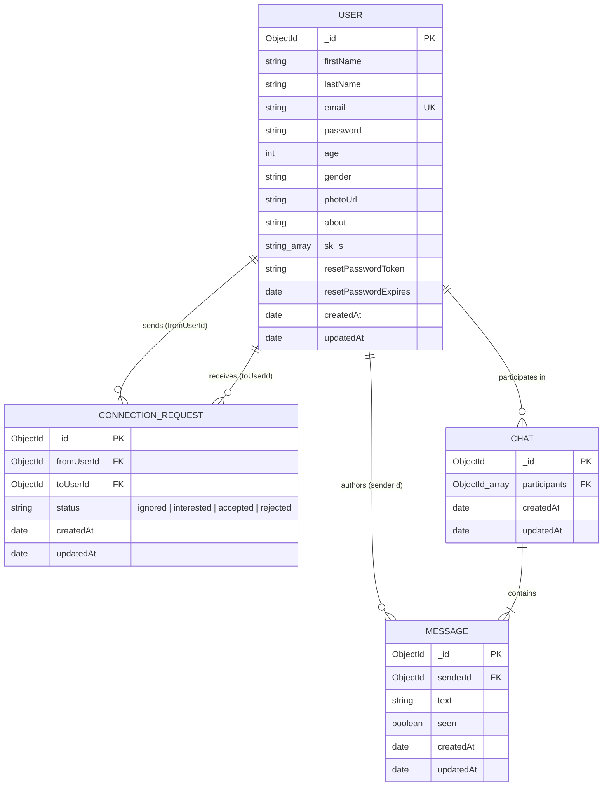

# Document 05: Database Architecture & Data Modeling

## 1. Database Technology Overview

HackPair is built upon **MongoDB Atlas**, a cloud-native, document-oriented NoSQL database. MongoDB was chosen over traditional relational SQL databases (e.g., PostgreSQL or MySQL) for several key reasons:

1. **Polymorphic Developer Profiles**: Developer profiles contain variable-length array structures (such as `skills: [String]`), flexible summaries, and photo metadata that naturally map to JSON/BSON document structures without requiring auxiliary join tables.
2. **Denormalized Messaging History**: Storing messages as an embedded sub-document array within a single `Chat` conversation document provides high read throughput and locality of reference for real-time live messaging.
3. **Mongoose 9 ODM**: Mongoose provides strong schema enforcement, field validation rules, lifecycle hooks (`pre-save`), and serialization transforms (`toJSON`), combining NoSQL flexibility with schema integrity.

---

## 2. Entity-Relationship (ER) Diagram



---

## 3. Schema Documentation & Data Dictionaries

### A. Collection: `users`
- **Model File**: [`src/models/user.js`](file:///c:/Backend/hackpair-backend/src/models/user.js)
- **Primary Key**: `_id` (ObjectId)
- **Indexes**:
  - `email`: Unique index (`{ unique: true, lowercase: true, trim: true }`).

| Field Name | Type | Required | Default | Constraints & Validations |
| :--- | :--- | :--- | :--- | :--- |
| `_id` | `ObjectId` | Auto | Generated | MongoDB unique identifier. |
| `firstName` | `String` | Yes | None | Trimmed, min length 2, max length 50. |
| `lastName` | `String` | No | None | Trimmed, max length 50. |
| `email` | `String` | Yes | None | Unique, trimmed, lowercase, validated via `validator.isEmail`. |
| `password` | `String` | Yes | None | Stored as bcrypt 60-character hash (cost 10). |
| `age` | `Number` | No | None | Min: 18, Max: 120. |
| `gender` | `String` | No | None | Lowercase, enum: `["male", "female", "others", "other"]`. |
| `photoUrl` | `String` | No | Default avatar placeholder | Validated via `validator.isURL` or `data:image/` prefix. |
| `about` | `String` | No | `"Passionate developer..."` | Trimmed, max length 500 characters. |
| `skills` | `[String]` | No | `[]` | Array of skill strings, maximum 20 items. |
| `resetPasswordToken` | `String` | No | None | 64-character SHA-256 hash of password reset token. |
| `resetPasswordExpires`| `Date` | No | None | Expiration timestamp (15 minutes from request). |
| `createdAt` | `Date` | Auto | `Date.now` | Timestamps enabled. |
| `updatedAt` | `Date` | Auto | `Date.now` | Timestamps enabled. |

#### Schema Serialization Transforms:
```javascript
toJSON: {
    transform: function (doc, ret) {
        delete ret.password;
        delete ret.resetPasswordToken;
        delete ret.resetPasswordExpires;
        delete ret.__v;
        return ret;
    },
}
```
*Why this is critical:* Guarantees that any Express call returning user documents (`res.send(user)`, `res.json({ data: user })`) automatically strips the bcrypt password hash and reset tokens, preventing accidental leaks over the network.

---

### B. Collection: `connectionrequests`
- **Model File**: [`src/models/connectionRequest.js`](file:///c:/Backend/hackpair-backend/src/models/connectionRequest.js)
- **Primary Key**: `_id` (ObjectId)
- **Indexes**:
  - Compound Index: `{ fromUserId: 1, toUserId: 1 }` for rapid pair matching queries.

| Field Name | Type | Required | Constraints & Description |
| :--- | :--- | :--- | :--- |
| `_id` | `ObjectId` | Auto | Unique identifier. |
| `fromUserId` | `ObjectId` | Yes | Reference (`ref: "User"`) to the sender. |
| `toUserId` | `ObjectId` | Yes | Reference (`ref: "User"`) to the recipient. |
| `status` | `String` | Yes | Strict Enum: `["ignored", "interested", "accepted", "rejected"]`. |
| `createdAt` | `Date` | Auto | Timestamps enabled. |
| `updatedAt` | `Date` | Auto | Timestamps enabled. |

#### Schema Lifecycle Hooks (`pre-save`):
```javascript
connectionRequestSchema.pre("save", function (next) {
    if (this.fromUserId.equals(this.toUserId)) {
        throw new Error("Cannot send connection request to yourself!");
    }
    if (typeof next === "function") next();
});
```
*Why this is critical:* Enforces data integrity at the database layer. Even if an attacker bypasses client-side checks or API validation, MongoDB blocks a user from connecting with or swiping on themselves.

---

### C. Collection: `chats`
- **Model File**: [`src/models/chat.js`](file:///c:/Backend/hackpair-backend/src/models/chat.js)
- **Primary Key**: `_id` (ObjectId)
- **Indexes**:
  - `{ participants: 1 }` for rapid conversation lookups by participant pair.

| Field Name | Type | Required | Description |
| :--- | :--- | :--- | :--- |
| `_id` | `ObjectId` | Auto | Conversation identifier. |
| `participants` | `[ObjectId]` | Yes | Array of exactly two `User` ObjectIds. |
| `messages` | `[MessageSchema]` | No | Embedded array of message subdocuments. |
| `createdAt` | `Date` | Auto | Timestamps enabled. |
| `updatedAt` | `Date` | Auto | Updated whenever a new message is appended. |

#### Subdocument Schema: `Message`
| Field Name | Type | Required | Default | Description |
| :--- | :--- | :--- | :--- | :--- |
| `_id` | `ObjectId` | Auto | Generated | Unique message ID. |
| `senderId` | `ObjectId` | Yes | None | Reference (`ref: "User"`) to author. |
| `text` | `String` | Yes | None | Trimmed message text, max 2000 chars. |
| `seen` | `Boolean` | No | `false` | Read receipt tracking. |
| `createdAt` | `Date` | Auto | `Date.now` | Message timestamp. |
| `updatedAt` | `Date` | Auto | `Date.now` | Message timestamp. |

---

## 4. Query Patterns & Database Optimization

### 1. Feed Exclusion Query
The feed query dynamically constructs an exclusion set to filter candidate profiles:
```javascript
const feedUsers = await User.find({
    _id: { $nin: Array.from(hideUsersFromFeed) },
})
    .select("firstName lastName photoUrl age gender about skills")
    .skip(skip)
    .limit(limit);
```
- **Projection Optimization**: Only safe, public fields are selected via `.select(...)`, minimizing network I/O and RAM overhead.
- **Pagination**: Uses `skip` and `limit` to serve bounded result pages.

### 2. Conversation Fetching & Merging
To render the messenger conversation list:
1. All `ConnectionRequest` documents with `status: "accepted"` involving the logged-in user are queried and populated.
2. The user's active `Chat` documents are queried.
3. The server merges the lists in-memory so even partners without existing chat messages appear as "Start a conversation", sorting by latest message timestamp descending.

