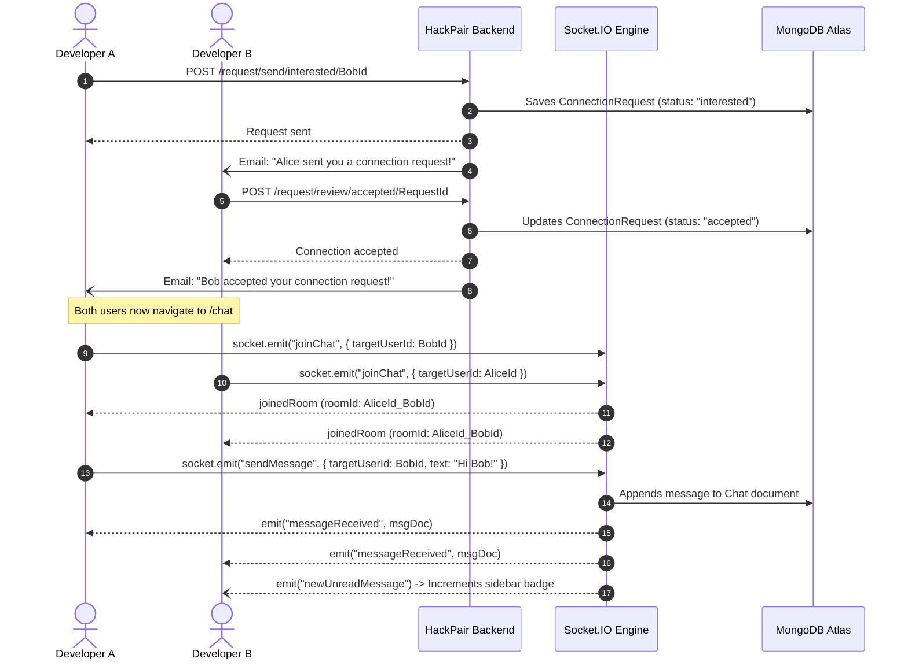

# Document 06: API Specification & Documentation

## 1. Authentication & Identity APIs

### 1.1 User Registration
- **Method & URL**: `POST /signup`
- **Purpose**: Registers a new developer account, hashes the password, and triggers an asynchronous welcome email.
- **Authentication**: Public (Rate-limited: 25 requests / 15 mins).
- **Request Body**:
```json
{
  "firstName": "John",
  "lastName": "Doe",
  "email": "john@example.com",
  "password": "StrongPassword!123",
  "age": 24,
  "gender": "male",
  "photoUrl": "https://example.com/avatar.png",
  "about": "Full-stack engineer interested in React and Node.js.",
  "skills": ["JavaScript", "React", "Node.js", "MongoDB"]
}
```
- **Success Response**: `HTTP 201 Created`
  ```text
  User Added Successfully!
  ```
- **Error Responses**:
  - `HTTP 400 Bad Request`: Validation failure (e.g., password weak, age < 18, skills > 20).
  - `HTTP 400 Bad Request`: `"You already have an account! Please log in."` (Duplicate email check or index error 11000).

---

### 1.2 User Login
- **Method & URL**: `POST /login`
- **Purpose**: Authenticates credentials, generates a 7-day signed JWT token, and attaches it as an `HttpOnly` cookie.
- **Authentication**: Public (Rate-limited: 25 requests / 15 mins).
- **Request Body**:
```json
{
  "email": "john@example.com",
  "password": "StrongPassword!123"
}
```
- **Success Response**: `HTTP 200 OK`
  - **Headers**: `Set-Cookie: token=<jwt>; Path=/; HttpOnly; SameSite=Lax (or None in prod); Expires=...`
  - **Body**: Sanitized User document (password and reset tokens automatically stripped).
- **Error Responses**:
  - `HTTP 400 Bad Request`: `"Email and password are required"`
  - `HTTP 400 Bad Request`: `"Invalid credentials"`

---

### 1.3 User Logout
- **Method & URL**: `POST /logout`
- **Purpose**: Invalidates the active session by expiring the `token` cookie.
- **Authentication**: Public.
- **Headers**: `Set-Cookie: token=; Path=/; Expires=Thu, 01 Jan 1970 00:00:00 GMT`
- **Success Response**: `HTTP 200 OK` `"Logout Successful!!"`

---

### 1.4 Request Password Reset Token
- **Method & URL**: `POST /forgotPassword` (and alias `/forgot-password`)
- **Purpose**: Generates a 32-byte cryptographic token, stores its SHA-256 hash in MongoDB (15-min expiry), and emails the reset link.
- **Authentication**: Public (Rate-limited: 25 requests / 15 mins).
- **Request Body**:
```json
{
  "email": "john@example.com"
}
```
- **Success Response**: `HTTP 200 OK`
  ```text
  If an account with that email exists, we have sent password reset instructions to it.
  ```

---

### 1.5 Apply Password Reset
- **Method & URL**: `POST /resetPassword` (and alias `/reset-password`)
- **Purpose**: Verifies cryptographic token hash and expiration, updates password to a new bcrypt hash.
- **Authentication**: Public (Rate-limited: 25 requests / 15 mins).
- **Request Body**:
```json
{
  "token": "4a7b9c...",
  "email": "john@example.com",
  "newPassword": "NewStrongPassword!456"
}
```
- **Success Response**: `HTTP 200 OK`
  ```text
  Password reset successfully! Please log in with your new password.
  ```
- **Error Responses**:
  - `HTTP 400 Bad Request`: `"Invalid or expired password reset token. Please request a new one."`

---

## 2. Profile Management APIs

### 2.1 View Current Profile
- **Method & URL**: `GET /profile/view` (and alias `/profile`)
- **Purpose**: Fetches the authenticated user's profile to initialize frontend session state.
- **Authentication**: `userAuth` middleware (Requires valid `token` cookie).
- **Success Response**: `HTTP 200 OK`
```json
{
  "_id": "6724...",
  "firstName": "John",
  "lastName": "Doe",
  "email": "john@example.com",
  "age": 24,
  "gender": "male",
  "photoUrl": "https://example.com/photo.png",
  "about": "Full-stack builder",
  "skills": ["React", "Node.js"],
  "createdAt": "2026-11-01T10:00:00.000Z"
}
```

---

### 2.2 Edit Profile Details
- **Method & URL**: `PATCH /profile/edit`
- **Purpose**: Updates permitted profile fields (whitelist enforced: `firstName`, `lastName`, `photoUrl`, `about`, `gender`, `age`, `skills`).
- **Authentication**: `userAuth` middleware.
- **Request Body**: Any subset of allowed fields.
- **Success Response**: `HTTP 200 OK`
```json
{
  "message": "John, your profile was updated successfully",
  "data": { ...updatedUser }
}
```
- **Error Responses**:
  - `HTTP 400 Bad Request`: `"Update not allowed for field(s): email, password"`

---

### 2.3 Change Password
- **Method & URL**: `PATCH /profile/password`
- **Purpose**: Re-authenticates using the current password and hashes a new password.
- **Authentication**: `userAuth` middleware.
- **Request Body**:
```json
{
  "currentPassword": "OldPassword!123",
  "newPassword": "BrandNewPassword!789"
}
```
- **Success Response**: `HTTP 200 OK` `"Password changed successfully!"`
- **Error Responses**:
  - `HTTP 400 Bad Request`: `"Invalid current password"`

---

## 3. Matchmaking & Connection APIs

### 3.1 Send Connection Request
- **Method & URL**: `POST /request/send/:status/:toUserId`
- **Purpose**: Expresses `"interested"` or `"ignored"` toward a candidate developer.
- **Authentication**: `userAuth` middleware.
- **URL Parameters**:
  - `status`: String (`"interested"` or `"ignored"`).
  - `toUserId`: String (Recipient MongoDB ObjectId).
- **Success Response**: `HTTP 200 OK`
```json
{
  "message": "John is interested in Alice",
  "data": {
    "_id": "6728...",
    "fromUserId": "6724...",
    "toUserId": "6725...",
    "status": "interested",
    "createdAt": "2026-11-05T01:00:00.000Z"
  }
}
```
- **Error Responses**:
  - `HTTP 400 Bad Request`: `"Invalid status type"`
  - `HTTP 400 Bad Request`: `"Connection Request Already Exists!!"`
  - `HTTP 404 Not Found`: `"User not found!"`

---

### 3.2 Review Connection Request
- **Method & URL**: `POST /request/review/:status/:requestId`
- **Purpose**: Accepts or rejects an incoming `"interested"` request.
- **Authentication**: `userAuth` middleware.
- **URL Parameters**:
  - `status`: String (`"accepted"` or `"rejected"`).
  - `requestId`: String (ConnectionRequest ObjectId).
- **Success Response**: `HTTP 200 OK`
```json
{
  "message": "Connection request accepted",
  "data": { ...connectionRequestDoc }
}
```
- **Error Responses**:
  - `HTTP 400 Bad Request`: `"Status not allowed! Allowed statuses: accepted, rejected"`
  - `HTTP 404 Not Found`: `"Connection request not found"` (Triggered if request ID is invalid or user is not the designated recipient).

---

## 4. Feed & Social Directory APIs

### 4.1 Discovery Feed
- **Method & URL**: `GET /feed` (and alias `/user/feed`)
- **Purpose**: Queries candidate developer profiles, excluding self and all profiles with existing bi-directional interaction.
- **Authentication**: `userAuth` middleware.
- **Query Parameters**:
  - `page`: Integer (Default: 1).
  - `limit`: Integer (Default: 10, Max: 50).
- **Success Response**: `HTTP 200 OK`
```json
{
  "message": "Feed fetched successfully",
  "page": 1,
  "limit": 10,
  "data": [
    {
      "_id": "6729...",
      "firstName": "Sarah",
      "lastName": "Connor",
      "photoUrl": "...",
      "about": "Systems & Rust programmer",
      "skills": ["Rust", "C++", "Docker"]
    }
  ]
}
```

---

### 4.2 Pending Received Requests
- **Method & URL**: `GET /user/requests/received` (and alias `/user/requests`)
- **Purpose**: Returns all incoming connection requests awaiting the logged-in user's review.
- **Authentication**: `userAuth` middleware.
- **Success Response**: `HTTP 200 OK`
```json
{
  "message": "Connection requests fetched successfully",
  "data": [
    {
      "_id": "6730...",
      "fromUserId": {
        "_id": "6724...",
        "firstName": "Alex",
        "lastName": "Rivera",
        "photoUrl": "...",
        "about": "Frontend engineer",
        "skills": ["Next.js", "Tailwind"]
      },
      "status": "interested",
      "createdAt": "..."
    }
  ]
}
```

---

### 4.3 Confirmed Connections
- **Method & URL**: `GET /user/connections`
- **Purpose**: Returns all accepted teammates where the logged-in user is either sender or recipient.
- **Authentication**: `userAuth` middleware.
- **Success Response**: `HTTP 200 OK`
```json
{
  "message": "Connections fetched successfully",
  "data": [
    {
      "_id": "6724...",
      "firstName": "Alex",
      "lastName": "Rivera",
      "photoUrl": "...",
      "about": "Frontend engineer",
      "skills": ["Next.js", "Tailwind"]
    }
  ]
}
```

---

## 5. Live Chat & Messaging APIs

### 5.1 Total Unread Message Count
- **Method & URL**: `GET /chat/unread-count`
- **Purpose**: Returns total count of unread messages across all conversations for the sidebar badge.
- **Authentication**: `userAuth` middleware.
- **Success Response**: `HTTP 200 OK`
```json
{
  "success": true,
  "unreadCount": 3
}
```

---

### 5.2 Conversation Threads List
- **Method & URL**: `GET /chat/conversations`
- **Purpose**: Returns all conversation threads merged with accepted partners, preview snippets, timestamps, and per-partner unread counts.
- **Authentication**: `userAuth` middleware.
- **Success Response**: `HTTP 200 OK`
```json
{
  "success": true,
  "conversations": [
    {
      "partner": {
        "_id": "6724...",
        "firstName": "Alex",
        "lastName": "Rivera",
        "photoUrl": "..."
      },
      "lastMessage": "Sounds great, let's build with Next.js!",
      "lastMessageTime": "2026-11-05T02:30:00.000Z",
      "unreadCount": 1
    }
  ]
}
```

---

### 5.3 Fetch Chat History & Auto-Mark Seen
- **Method & URL**: `GET /chat/:targetUserId`
- **Purpose**: Retrieves chat history between the logged-in user and target partner, automatically marking unread incoming messages as seen.
- **Authentication**: `userAuth` middleware (Verifies users are accepted connections).
- **Success Response**: `HTTP 200 OK`
```json
{
  "success": true,
  "targetUser": { "_id": "...", "firstName": "Alex", ... },
  "messages": [
    {
      "_id": "6735...",
      "senderId": "6724...",
      "text": "Hey Manoj!",
      "seen": true,
      "createdAt": "2026-11-05T02:20:00.000Z"
    }
  ]
}
```
- **Error Responses**:
  - `HTTP 403 Forbidden`: `"You can only view chat history with accepted connections."`

---

## 6. Integration Flow: Matchmaking to Live Chat



